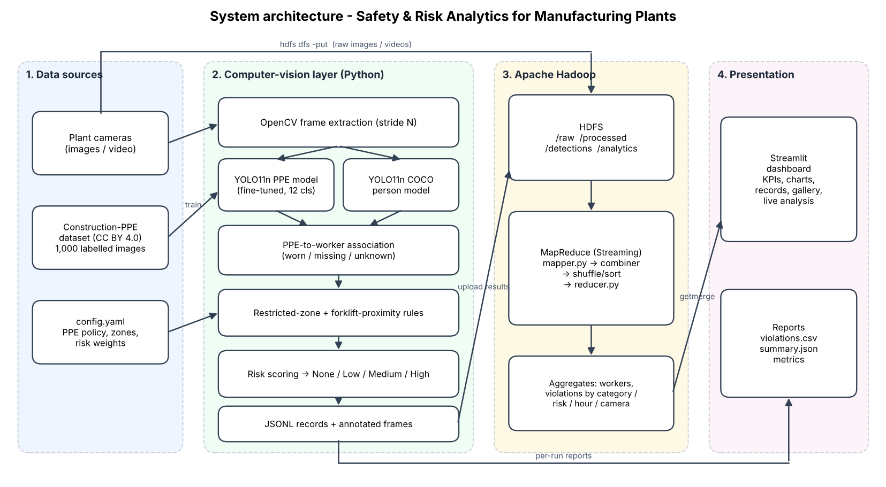
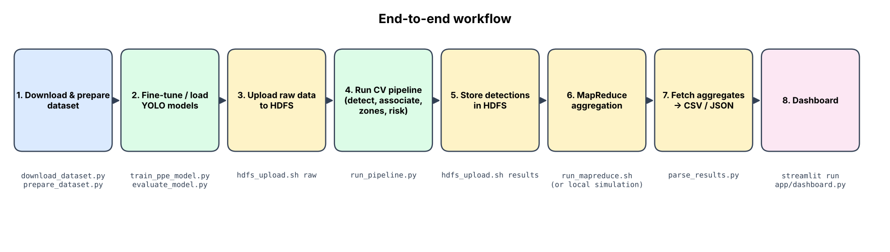
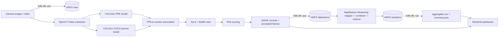
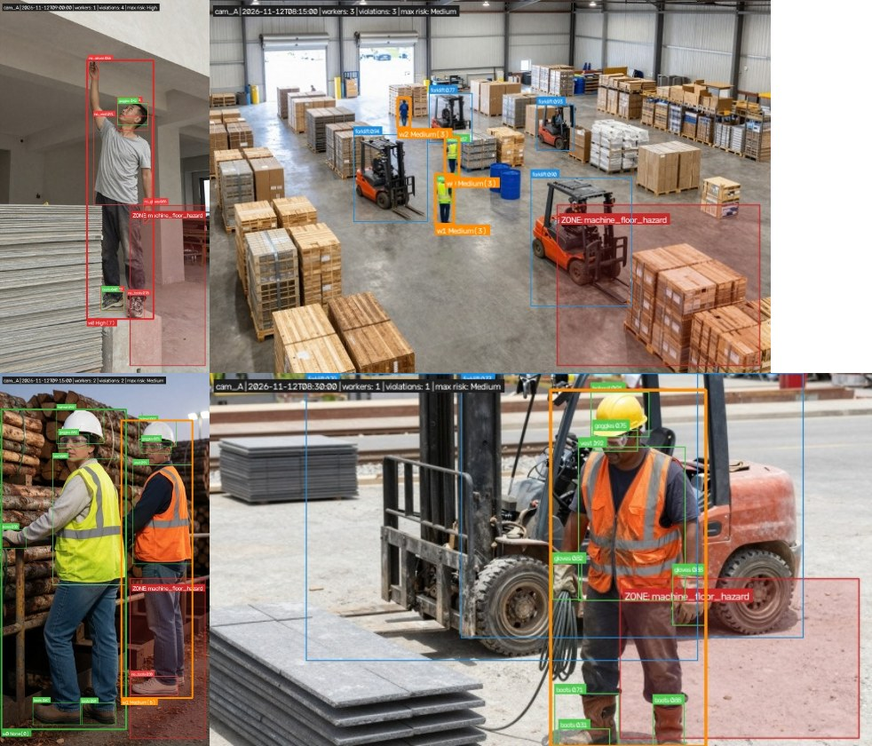
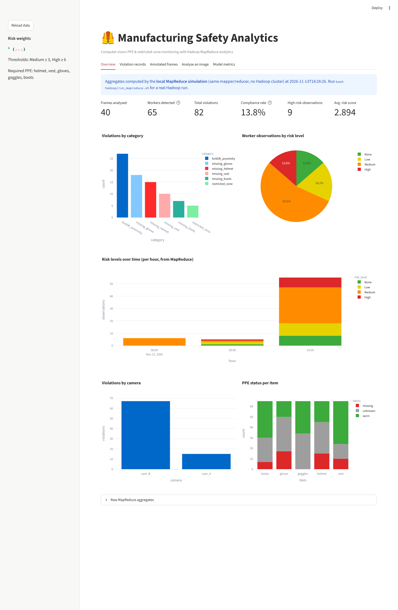
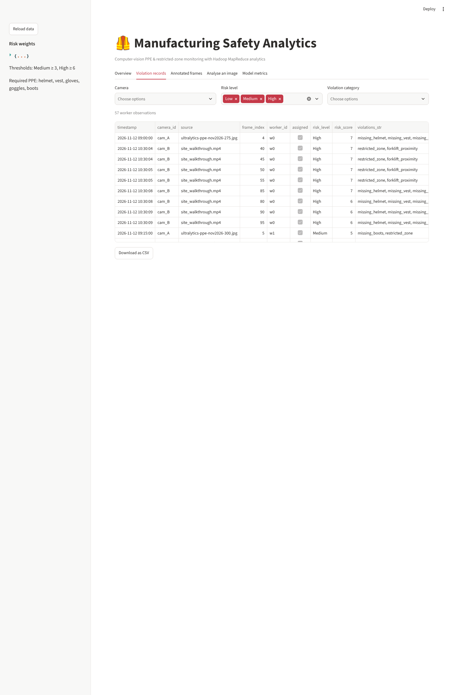
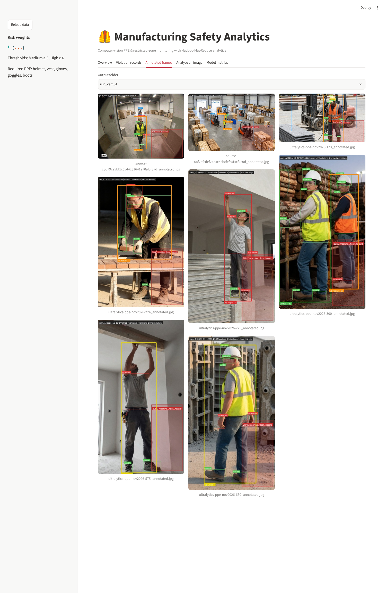
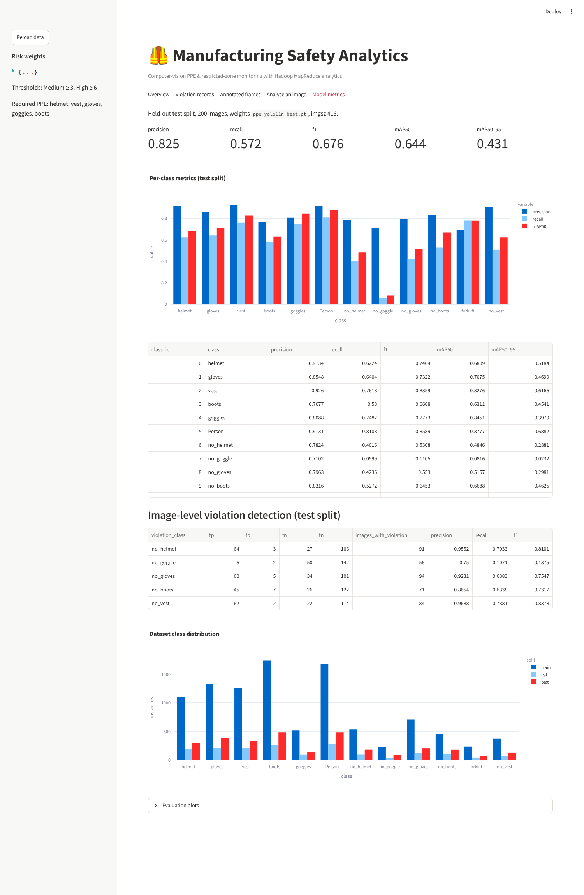

# Safety and Risk Analytics for Manufacturing Plants Using Computer Vision

**Stack:** Python · OpenCV · Ultralytics YOLO11 · Apache Hadoop (HDFS + MapReduce Streaming) · Pandas/NumPy · Streamlit · Docker

An end-to-end academic project that analyses plant images and video, detects workers and
their personal protective equipment (PPE), flags safety violations, assigns a Low / Medium /
High risk level to every worker observation, stores raw data and detection records in HDFS,
aggregates them with a Hadoop MapReduce job, and presents the results in an interactive
dashboard.

> **Honesty notes (read first)**
> * All model metrics in this README were **measured** on a held-out test split by
>   `scripts/evaluate_model.py`; nothing is estimated or invented. The bundled model was
>   trained briefly **on a CPU**, so its accuracy is modest (see [Results](#14-results)).
> * The **MapReduce outputs bundled in `outputs/analytics/` were produced by the local
>   simulation** (`hadoop/local_mapreduce.py`) because the build environment had no
>   Hadoop installation and no Docker. The real-Hadoop scripts and the Docker cluster are
>   included and complete but were **not executed by the author's build**; see
>   [section 9](#9-hadoop-setup-and-execution). The dashboard always shows which mode
>   produced the numbers.
> * The sample "video" is a **synthetic slideshow** made from dataset photos, not CCTV.
> * The system does **not** detect accidents, falls or unsafe activities. It detects PPE
>   compliance, restricted-zone entry and worker–forklift proximity only.

---

## Contents
1. [Introduction](#1-introduction) · 2. [Problem statement](#2-problem-statement) ·
3. [Objectives](#3-objectives) · 4. [Literature review](#4-literature-review) ·
5. [Dataset](#5-dataset) · 6. [System architecture](#6-system-architecture) ·
7. [Technology stack](#7-technology-stack) · 8. [Methodology](#8-implementation-methodology) ·
9. [Hadoop setup](#9-hadoop-setup-and-execution) · 10. [Folder structure](#10-project-folder-structure) ·
11. [Installation](#11-installation) · 12. [Running the project](#12-running-the-project) ·
13. [Sample outputs](#13-sample-outputs) · 14. [Results](#14-results) ·
15. [Limitations](#15-limitations) · 16. [Future work](#16-future-improvements)

---

## 1. Introduction
Manufacturing and construction sites remain among the most hazardous workplaces. Head
injuries, contact with moving machinery and collisions with vehicles such as forklifts
account for a large share of serious incidents, and correct use of PPE is one of the most
basic controls. Supervisors cannot watch every camera continuously, so compliance is
usually checked by periodic walk-throughs. Computer vision can watch every frame, and a
big-data back end can turn millions of detections into trends a safety officer can act on.

## 2. Problem statement
Given images or video from plant cameras, automatically
1. find each worker,
2. decide which required PPE items each worker is visibly wearing or visibly missing,
3. detect entry into predefined hazardous zones and proximity to forklifts,
4. convert these observations into an interpretable risk level, and
5. store and aggregate the resulting records at scale so that violations can be analysed
   by category, risk level, camera and time.

## 3. Objectives
| # | Objective | Implemented by |
|---|---|---|
| 1 | PPE detection (helmet, vest, gloves, goggles, boots) | fine-tuned YOLO11n, `computer_vision/detector.py` |
| 2 | Person detection | PPE model `Person` class + COCO YOLO11n, merged |
| 3 | Restricted-zone monitoring | normalised polygons, foot-point test, `computer_vision/zones.py` |
| 4 | Safety-violation detection | PPE-to-worker association, `computer_vision/safety_analysis.py` |
| 5 | Risk classification (Low/Medium/High) | weighted rule score, `computer_vision/risk.py` |
| 6 | Analytics dashboard | Streamlit, `app/dashboard.py` |
| 7 | Hadoop integration | HDFS storage + MapReduce Streaming job, `hadoop/` |

## 4. Literature review
A full review with references is in **[docs/LITERATURE_REVIEW.md](docs/LITERATURE_REVIEW.md)**.
In short: deep-learning detectors (Faster R-CNN, then the YOLO family) are the established
approach to hard-hat and vest detection on construction sites (Fang et al. 2018; Wu et al.
2019; Nath et al. 2020). Datasets with explicit *negative* classes (e.g. `no_helmet`) let a
model report violations positively instead of inferring them from a missing detection.
Zone intrusion and vehicle proximity are typically rule-based layers on top of person
detection. Hadoop's role in video analytics is durable storage (HDFS) and batch aggregation
of detection logs (MapReduce), with inference running outside MapReduce.
*The review was written without web access; references marked "from memory" must be
checked before submission.*

## 5. Dataset
**Ultralytics Construction-PPE** – CC BY 4.0 – ~1,000 images in YOLO format.
* Download URL: `https://github.com/ultralytics/assets/releases/download/v0.0.0/construction-ppe.zip` (~650 MB)
* Documentation: https://docs.ultralytics.com/datasets/detect/construction-ppe
* 12 classes: `helmet, gloves, vest, boots, goggles, Person, no_helmet, no_goggle, no_gloves, no_boots, forklift, no_vest`

`scripts/prepare_dataset.py` resizes images to ≤ 640 px, validates every label, and
re-splits the data so that the test set is never seen during training or model selection:

| Split | Images | Boxes | Source |
|---|---|---|---|
| train | 680 | 10,166 | 85 % of original *train* (seed 42) |
| val | 120 | 1,736 | 15 % of original *train* – used for checkpoint selection |
| **test** | **200** | **2,961** | original *val* – held out, used only for final metrics |

Per-class counts: `outputs/metrics/dataset_class_distribution.csv`. The dataset is **not**
included in the ZIP; 8 test images are bundled in `data/sample/images/` (with attribution).

## 6. System architecture






## 7. Technology stack
| Layer | Technology | Role |
|---|---|---|
| Language | Python 3.10–3.12 | all components |
| Vision | OpenCV | video decoding, drawing, image I/O |
| Detection | Ultralytics YOLO11n (PyTorch) | PPE, person and forklift detection |
| Storage | Apache Hadoop HDFS 3.3.6 | raw media, annotated frames, detection records, results |
| Processing | Hadoop MapReduce (Streaming) on YARN | distributed aggregation of violation records |
| Analytics | Pandas, NumPy | record handling, fallback aggregation |
| UI | Streamlit + Plotly | dashboard |
| Deployment | Docker, Docker Compose | single-node Hadoop cluster and app container |

## 8. Implementation methodology

### 8.1 Detection
* **PPE model** – YOLO11n (COCO-pretrained) fine-tuned on Construction-PPE
  (`scripts/train_ppe_model.py`). It detects PPE items, their explicit absence
  (`no_helmet`, …), persons and forklifts.
* **Person model** – COCO YOLO11n restricted to class `person`.
* **Merging** (`detection.person_source: both`) – person boxes from both models are merged
  by greedy NMS (IoU ≥ 0.5) plus a coverage rule: a lower-confidence box is dropped when
  already-kept boxes cover ≥ 70 % of it. This removes a single box spanning two adjacent
  workers, a failure observed on the sample images.

### 8.2 PPE association and violation logic
Each PPE box is attached to the person box that contains the largest share of it
(≥ 50 %). For every item the worker's status becomes:

| Status | Condition |
|---|---|
| `worn` | a positive box (e.g. `helmet`) is attached and is more confident than any negative box |
| `missing` | a negative box (e.g. `no_helmet`) is attached and is more confident |
| `unknown` | neither was detected – item may be occluded or out of frame |

Only `missing` items listed in `ppe_policy.required` become violations. Setting
`ppe_policy.treat_unknown_as_missing: [helmet, vest]` gives a stricter policy. Negative
boxes that cannot be attached to any person are still logged as *unassigned* violations.

### 8.3 Restricted zones and forklift proximity
Zones are polygons in normalised coordinates (`zones:` in the config), optionally per
camera. A worker is inside a zone when the bottom-centre of their box (foot point) lies in
the polygon. A worker is *near a forklift* when the gap between the foot point and the
forklift box is less than 0.75 × the worker's box height. A person whose box lies mostly
inside a forklift box *and* whose feet are clearly above the forklift's ground line (seated
in the cab) is treated as the operator and not flagged; a pedestrian standing in front of a
forklift overlaps it in the image too, but stands on the ground and is flagged.

### 8.4 Risk scoring
A transparent weighted sum per worker per frame (weights in `config.yaml`):

| Condition | Points |
|---|---|
| missing helmet | 3 |
| missing vest | 2 |
| missing gloves / goggles / boots | 1 each |
| inside restricted zone | 4 |
| near forklift | 3 |

**Score 0 → None · 1–2 → Low · 3–5 → Medium · ≥ 6 → High.**
Example: no helmet inside the hazard zone = 3 + 4 = 7 → High.
This is a heuristic for demonstration, not a validated occupational-risk model.

### 8.5 Records
`scripts/run_pipeline.py` writes, per run folder:
* `detections/observations.jsonl` – one record per worker per analysed frame (PPE status,
  violations, zones, risk score/level, timestamp, camera)
* `detections/frames.jsonl` – one record per frame, with all raw detections
* `reports/violations.csv`, `reports/summary.json`, `annotated/*.jpg|mp4`

Still images have no reliable capture time, so they receive *assigned* timestamps
(`--start-time`, `--interval`); video frames get `start + frame/fps`. Every record stores
its `timestamp_source`.

### 8.6 MapReduce job
`hadoop/mapper.py` reads JSON lines and emits `metric|dimension<TAB>count`;
`hadoop/reducer.py` sums counts per key and is also used as the **combiner**. Computed
metrics: total workers detected, total violations, violations by category, by risk level,
by camera, by hour and by date, risk level per hour, PPE status per item, frames with
violations, and the sum of risk scores (for the average). `hadoop/parse_results.py` turns
the output into `outputs/analytics/aggregates.csv` and `analytics_summary.json`, recording
the execution mode (`hadoop-native`, `hadoop-docker` or `local-simulation`).

## 9. Hadoop setup and execution

### 9.1 Option A – bundled Docker cluster (recommended)
`docker/hadoop/Dockerfile` builds a single-node, pseudo-distributed **Hadoop 3.3.6**
(NameNode, DataNode, ResourceManager, NodeManager, JobHistory) on Java 11, with Python 3
for the Streaming tasks. The project folder is mounted at `/project` in the container.

```bash
docker compose up -d --build hadoop      # first build downloads Hadoop (~700 MB)
docker logs -f msa-hadoop                # wait for "Hadoop is ready"
# Web UIs: NameNode http://localhost:9870   YARN http://localhost:8088
```

### 9.2 Option B – existing Hadoop installation
If `hdfs` and `hadoop` are on your `PATH` (and `python3` is available on the worker
nodes), the scripts use them directly. Set `FORCE_DOCKER=1` to prefer the container.

### 9.3 Workflow commands
```bash
bash hadoop/hdfs_upload.sh raw                              # 1. raw images/videos -> HDFS
python scripts/run_pipeline.py --input data/sample/images --camera cam_A --out outputs/run_cam_A
bash hadoop/hdfs_upload.sh results outputs/run_cam_A        # 3. detection records -> HDFS
bash hadoop/run_mapreduce.sh                                # 4. MapReduce + 5. fetch results
```
Equivalent raw Hadoop commands run by the scripts:
```bash
hdfs dfs -mkdir -p /safety_analytics/raw/images /safety_analytics/detections/run_cam_A
hdfs dfs -put -f data/sample/images/* /safety_analytics/raw/images/
hdfs dfs -put -f outputs/run_cam_A/detections/*.jsonl /safety_analytics/detections/run_cam_A/
hadoop jar $HADOOP_HOME/share/hadoop/tools/lib/hadoop-streaming-*.jar \
  -D mapreduce.job.reduces=1 \
  -files hadoop/mapper.py,hadoop/reducer.py \
  -mapper "python3 mapper.py" -combiner "python3 reducer.py" -reducer "python3 reducer.py" \
  -input "/safety_analytics/detections/*/*.jsonl" \
  -output /safety_analytics/analytics/mapreduce_output
hdfs dfs -cat /safety_analytics/analytics/mapreduce_output/part-* > outputs/analytics/mapreduce_part-00000.txt
```

### 9.4 Option C – local simulation (no Hadoop)
```bash
bash hadoop/run_local_simulation.sh
# same as: cat outputs/*/detections/*.jsonl | python3 hadoop/mapper.py | sort | python3 hadoop/reducer.py
```
This runs the **same** mapper and reducer through a map → combine → sort → reduce pipe and
labels the result `local-simulation`. It verifies the MapReduce logic but **does not
exercise HDFS, YARN or distribution**.

| What | Verified in the author's build? |
|---|---|
| mapper/reducer logic, combiner correctness | ✅ unit tests + local simulation |
| `hdfs_upload.sh`, `run_mapreduce.sh` against a live cluster | ❌ not executed (no Hadoop/Docker in build environment) |
| Docker Hadoop image build | ❌ not executed – written against Hadoop 3.3.6 docs |

## 10. Project folder structure
```
manufacturing-safety-analytics/
├── app/                      Streamlit dashboard (dashboard.py, data_loader.py)
├── computer_vision/          detector, PPE association, zones, risk, visualisation, pipeline
├── config/config.yaml        classes, PPE policy, zones, risk weights, HDFS paths
├── hadoop/                   mapper.py, reducer.py, hdfs_upload.sh, run_mapreduce.sh,
│                             common.sh, parse_results.py, local_mapreduce.py, run_local_simulation.sh
├── docker/hadoop/            Hadoop 3.3.6 image: Dockerfile, *-site.xml, entrypoint.sh
├── scripts/                  download/prepare dataset, download weights, train, evaluate,
│                             run_pipeline, make_sample_video, make_diagrams, capture_dashboard,
│                             run_end_to_end.sh
├── data/sample/              8 test images + synthetic demo video (CC BY 4.0 source)
├── models/                   ppe_yolo11n_best.pt (+ .json); README for other weights
├── outputs/                  sample results: run_cam_A/, run_cam_B/, analytics/, metrics/
├── docs/                     architecture.png, workflow.png, LITERATURE_REVIEW.md,
│                             RESULTS.md, screenshots/
├── tests/                    pytest suite (logic, MapReduce, pipeline smoke test)
├── Dockerfile                app image (CPU PyTorch + Streamlit)
├── docker-compose.yml        hadoop + dashboard (+ pipeline tool) services
├── requirements.txt
└── README.md
```

## 11. Installation

**Hardware.** Any x86-64 machine with ≥ 8 GB RAM and ~3 GB free disk runs inference and the
dashboard on CPU (~0.2–0.5 s per image). Training on CPU is possible but slow (≈ 2 min
per epoch at 416 px on the author's machine); an NVIDIA GPU is recommended for longer
training. The Docker Hadoop cluster needs ~4 GB RAM.

**Software.** Python 3.10–3.12, pip; optionally Docker ≥ 24 with Compose v2; Linux/macOS
shell or WSL2 on Windows for the `.sh` scripts.

```bash
cd manufacturing-safety-analytics
python -m venv .venv && source .venv/bin/activate      # Windows: .venv\Scripts\activate
# CPU-only PyTorch first (skip if you have CUDA and want the GPU build):
pip install torch torchvision --index-url https://download.pytorch.org/whl/cpu
pip install -r requirements.txt
python scripts/download_weights.py                      # COCO yolo11n.pt -> models/
pytest -q                                               # all tests should pass
```

## 12. Running the project

**Fastest path – everything on the bundled samples:**
```bash
bash scripts/run_end_to_end.sh          # uses Hadoop if available, else the local simulation
streamlit run app/dashboard.py          # http://localhost:8501
```

**Step by step:**
```bash
# (optional) dataset + training + evaluation
python scripts/download_dataset.py
python scripts/prepare_dataset.py
python scripts/train_ppe_model.py --epochs 30 --imgsz 416    # GPU: --device 0 --imgsz 640 --epochs 100
python scripts/evaluate_model.py --imgsz 416

# inference
python scripts/run_pipeline.py --input data/sample/images --camera cam_A --out outputs/run_cam_A \
       --start-time 2026-11-12T08:00:00 --interval 900 --fresh
python scripts/run_pipeline.py --input path/to/video.mp4 --camera cam_B --out outputs/run_cam_B --stride 5

# analytics (pick one)
bash hadoop/run_mapreduce.sh            # real Hadoop (section 9)
bash hadoop/run_local_simulation.sh     # no Hadoop

# dashboard
streamlit run app/dashboard.py
```

**With Docker only:**
```bash
docker compose up -d --build hadoop dashboard
docker compose run --rm pipeline python scripts/run_pipeline.py --input data/sample/images --camera cam_A --out outputs/run_cam_A
bash hadoop/hdfs_upload.sh results outputs/run_cam_A && bash hadoop/run_mapreduce.sh
# dashboard: http://localhost:8501
```

**Configure zones for your camera:** edit `zones:` in `config/config.yaml` – coordinates
are fractions of image width/height, so `[[0,0.5],[0.5,0.5],[0.5,1],[0,1]]` is the
bottom-left quarter.

## 13. Sample outputs
Annotated detections on held-out test images (worker boxes coloured by risk: green None,
yellow Low, orange Medium, red High; small green/red boxes are worn/missing PPE; blue boxes
are forklifts; the red shaded area is the demonstration hazard zone):



Dashboard screenshots (captured with `scripts/capture_dashboard.py`):

| Overview | Violation records |
|---|---|
|  |  |
| **Annotated frames** | **Model metrics** |
|  |  |

Bundled result files:

| File | Content |
|---|---|
| `outputs/run_cam_A/annotated/*.jpg` | annotated sample images |
| `outputs/run_cam_B/annotated/site_walkthrough_annotated.mp4` | annotated demo video + key frames |
| `outputs/run_cam_*/detections/*.jsonl` | detection and violation records (MapReduce input) |
| `outputs/run_cam_*/reports/violations.csv` | violation report per worker observation |
| `outputs/analytics/mapreduce_part-00000.txt` | raw reducer output |
| `outputs/analytics/aggregates.csv`, `analytics_summary.json` | aggregated analytics |
| `outputs/metrics/` | test metrics, per-class metrics, PR curves, confusion matrix, training curves |

## 14. Results
Full details: **[docs/RESULTS.md](docs/RESULTS.md)**. All values measured by the
repository scripts.

**Held-out test split (200 images)** – YOLO11n, 17 CPU epochs at 416 px:

| Precision | Recall | F1 | mAP@0.5 | mAP@0.5:0.95 |
|---|---|---|---|---|
| 0.825 | 0.572 | 0.676 | 0.644 | 0.431 |

**Image-level violation detection (test split, conf ≥ 0.30):**

| Violation | Precision | Recall | F1 |
|---|---|---|---|
| no_helmet | 0.955 | 0.703 | 0.810 |
| no_vest | 0.969 | 0.738 | 0.838 |
| no_gloves | 0.923 | 0.638 | 0.755 |
| no_boots | 0.865 | 0.634 | 0.732 |
| no_goggle | 0.750 | 0.107 | 0.188 |

Helmet, vest and glove alerts are precise (> 0.9) but about a third of violating images are
missed; **missing goggles are effectively not detected**. On the bundled samples, the
MapReduce job (local simulation) aggregated 40 frames, 65 worker observations and 82
violations, matching the per-run pipeline totals exactly. Those sample numbers are
illustrative only.

## 15. Limitations
* **Model accuracy.** The bundled weights come from a short CPU training run (17 epochs,
  416 px, 680 images). Negative classes are detected with high precision but low recall,
  and **missing goggles are practically undetectable** (recall 0.11). Small, distant
  workers often get `unknown` PPE status. Treat individual
  alerts as candidates for human review.
* **Domain gap.** The dataset is mainly construction and warehouse imagery; real
  manufacturing lines (different PPE, lighting, camera angles) would need site-specific
  images and labels.
* **No tracking.** Each frame is analysed independently, so in video the same worker is
  counted once per analysed frame ("worker observations"), not once per person.
* **Rule-based risk.** Weights and thresholds are illustrative, not derived from incident
  data. Zone polygons must be set per camera; the bundled zone is a demonstration region.
* **Forklift proximity** uses 2-D image distance and does not estimate depth, so a worker
  far behind a forklift can be flagged, and the "seated operator" test can misfire for
  unusual camera angles.
* **Hadoop.** Bundled analytics were produced by the local simulation; the cluster path was
  not run in the author's environment. Inference runs outside Hadoop (on one machine), and
  Hadoop adds overhead that only pays off at much larger data volumes than the samples.
* **Not detected:** accidents, falls, unsafe postures or activities, fire/smoke, PPE fit or
  correctness (e.g. an unfastened helmet).

## 16. Future improvements
* Train longer on a GPU at 640 px and add manufacturing-specific data such as SH17.
* Multi-object tracking (e.g. ByteTrack) to count unique workers and violation durations.
* Run inference inside the cluster (Spark + GPU executors) and stream records with Kafka.
* Pose estimation for unsafe postures; temporal models for fall detection where labelled
  data exists.
* Calibrated cameras / homography for metric distances to forklifts and machinery.
* Interactive zone editor in the dashboard and alerting (email/Slack) for High risk.

## Licence and attribution
Project code: MIT-style academic use. Dataset and sample images: Ultralytics
Construction-PPE, **CC BY 4.0**. Ultralytics YOLO is **AGPL-3.0**.
